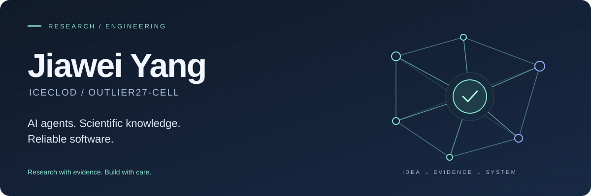

  <a href="#about">About</a> &nbsp; / &nbsp;
  <a href="#education">Education</a> &nbsp; / &nbsp;
  <a href="#selected-work">Selected work</a> &nbsp; / &nbsp;
  <a href="#research">Research</a> &nbsp; / &nbsp;
  <a href="#open-source">Open source</a> &nbsp; / &nbsp;
  <a href="mailto:202383014@uibe.edu.cn">Contact ↗</a>

<h2 id="about">Hi, I'm Jiawei · 杨嘉伟</h2>

I work at the intersection of **AI agents, scientific knowledge extraction, and reliable software**. I like turning research ideas into inspectable workflows: clear evidence, explicit boundaries, and tools people can actually use.

我关注多智能体协作、科研图表与表格理解、知识图谱，以及从研究原型到可靠工具的工程实践。

- **Education** · B.Eng. student in Data Science and Big Data Technology at the University of International Business and Economics (UIBE).
- **Research experience** · Multimodal information extraction and scientific-document processing at the Chinese Academy of Sciences.
- **Building** · Agent evaluation environments, evidence-aware research assistants, and full-stack applications.
- **Contributing** · Agent runtimes, diagram tooling, accessibility, and Windows compatibility.

<h2 id="education">Education · 教育背景</h2>

**University of International Business and Economics · 对外经济贸易大学** 
School of Artificial Intelligence and Data Science · 人工智能与数据科学学院

- **Degree** · B.Eng. in Data Science and Big Data Technology, in progress · 数据科学与大数据技术（工学学士，在读）
- **Period** · September 2023–present · 2023.09–至今
- **Academic record** · Average score **90.56/100** · Major rank **1/34**
- **Selected coursework** · Natural Language Processing **100/100** · Data Visualization **99/100**

**Tsinghua Shenzhen International Graduate School · 清华大学深圳国际研究生院**

- **Program** · Master's program in Electronic Information · 电子信息硕士
- **Direction** · Internet + Innovation Design · 互联网+创新设计
- **Admission status** · Preliminary admission through postgraduate recommendation · **推免初步录取**

**Selected honors · 获奖情况** · 国家励志奖学金 · 计算机设计大赛全国三等奖 · 华北五省计算机应用大赛国家级一等奖

<h2 id="selected-work">Selected work</h2>

<table>
<tr>
<td width="50%" valign="top">
01 / AGENT EVALUATION
<h3><a href="https://github.com/outlier27-cell/workspace-bench-environment-agent-api">Workspace Environment Agent ↗</a></h3>

A workspace-evolution demo and API connecting user profiles, events, file dependencies, and tasks.

<strong>Python · FastAPI · Dependency graphs</strong>

<a href="https://outlier27-cell.github.io/workspace-bench-environment-agent-api/">Explore the visual demo</a> · <a href="https://github.com/outlier27-cell/workspace-bench-environment-agent-api/blob/main/API.md">API guide</a>

Independent demo. Default planning is rule-based, with a pluggable backend for model integration.
</td>
<td width="50%" valign="top">
02 / SCIENTIFIC WORKFLOWS
<h3><a href="https://github.com/outlier27-cell/nature-rebuttal-lens">Nature RebuttalLens ↗</a></h3>

A manuscript-aware, multi-agent assistant connecting reviewer concerns to evidence, response plans, and auditable traces.

<strong>Python · Multi-agent workflows · Evidence tracing</strong>

<a href="https://github.com/outlier27-cell/nature-rebuttal-lens#worked-example">See the worked example</a>

Independent research tool; not affiliated with Nature Portfolio.
</td>
</tr>
</table>

<table>
<tr><td valign="top">
03 / FULL-STACK ENGINEERING
<h3><a href="https://github.com/outlier27-cell/courseops-web-final">CourseOps ↗</a></h3>

A course-project operations system for course spaces, materials, submissions, feedback, analytics, notifications, and audit logs.

<strong>Vue 3 · Vite · Spring Boot · MySQL · MongoDB</strong>

<a href="https://github.com/outlier27-cell/courseops-web-final#local-run">Run locally</a> · <a href="https://github.com/outlier27-cell/courseops-web-final/tree/main/docs">Documentation</a>
</td></tr>
</table>

<h2 id="research">Research</h2>

My research connects **structured knowledge, multimodal models, and agent evaluation**. Publication statuses below follow my CV; work under review is listed as such.

| Work | Research question | Role & status |
| :--- | :--- | :--- |
| **FinanceAI** | How can temporal macro-graphs and bounded LLM advice inform daily ETF allocation? | First author · NLPCC · Accepted for presentation |
| **ChartChain** | How can collaborating agents turn scientific charts into verifiable knowledge chains? | First author · IEEE TKDE · Under review |
| **BioTRACE** | How can source-isolated evaluation reduce leakage in knowledge-chain extraction from genomics tables? | First author · WSDM · Under review |

**Workspace-Bench 1.0** · Contributed task metadata, file-dependency graphs, and Lite/Full evaluation subsets in collaboration with Prof. Xuanhe Zhou's group at Shanghai Jiao Tong University. The benchmark described in my CV covers 20,476 files and 388 tasks; the public Environment Agent repository above is a separate demo/API.

<h2 id="open-source">Open source</h2>

I contribute through reproductions, focused fixes, regression tests, and review follow-through. These are **upstream projects I contribute to**; the copies on my profile are contribution forks.

| Project | My contribution focus | Selected merged work |
| :--- | :--- | :--- |
| [**Archify**](https://github.com/tt-a1i/archify) | Diagram validation, Viewer accessibility, export reliability | [Crossing-analysis bounds #876](https://github.com/tt-a1i/archify/pull/876) · [Keyboard navigation #899](https://github.com/tt-a1i/archify/pull/899) · [SVG theme exports #536](https://github.com/tt-a1i/archify/pull/536) |
| [**OpenPI**](https://github.com/openpi-dev/openpi) | Agent runtime limits, workflow correctness, Windows support | [Bound child executions #617](https://github.com/openpi-dev/openpi/pull/617) · [Bound workflow probes #783](https://github.com/openpi-dev/openpi/pull/783) · [Windows commands #630](https://github.com/openpi-dev/openpi/pull/630) |
| [**Hive**](https://github.com/tt-a1i/hive) | CLI-agent collaboration and cross-platform reliability | [Cancellation handling #51](https://github.com/tt-a1i/hive/pull/51) · [Windows prefix coverage #48](https://github.com/tt-a1i/hive/pull/48) |

[Browse my merged contributions ↗](https://github.com/search?q=author%3Aoutlier27-cell+is%3Apr+is%3Amerged&type=pullrequests)

<h2>Tools I work with</h2>

**Research & AI** &nbsp; Python · PyTorch · LLMs · Multi-agent systems · Knowledge graphs 
**Data & retrieval** &nbsp; FAISS · Chroma · MongoDB 
**Application development** &nbsp; TypeScript / JavaScript · Vue · FastAPI · Spring Boot 
**Engineering practice** &nbsp; Git · Regression testing · Browser validation · CI

---

<strong>Have a research question or an open-source problem worth solving?</strong> <a href="mailto:202383014@uibe.edu.cn">202383014@uibe.edu.cn</a>

Jiawei Yang · IceClod &nbsp; / &nbsp; Research with evidence. Build with care.

